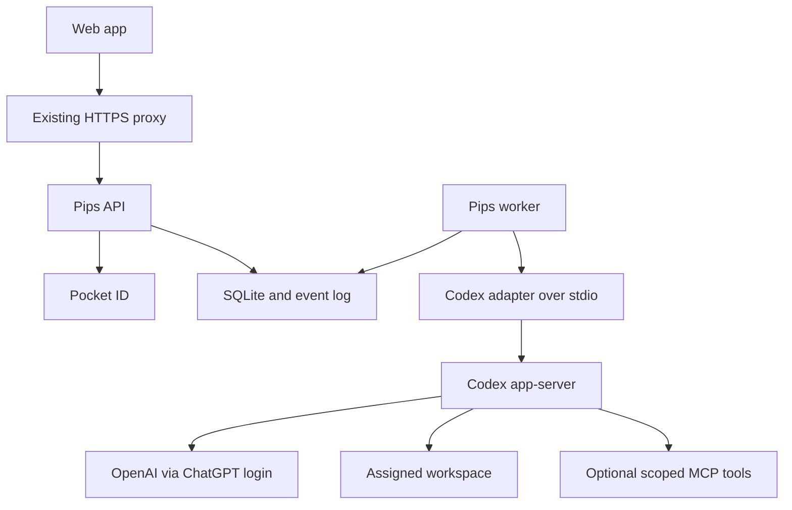

# Architecture and module boundaries

## Recommendation

Current deployment decision: Docker Compose behind existing Traefik. See [07-session-poc.md](07-session-poc.md) for the narrower session-first scope. References to a later scheduler or integration modules describe extension boundaries, not PoC deliverables.

Use a modular monolith with two runtime processes: web/API and worker. Shared domain code and one SQLite database keep deployment small. Separate processes let execution continue independently of HTTP connections. No Redis or external queue initially. A scheduler later runs inside the single worker; isolate it behind an interface.

Proposed stack: React/TypeScript frontend, FastAPI/Python API and worker, SQLite in WAL mode on local disk, Codex app-server child process over stdio. This remains a decision for review: an all-TypeScript backend could reduce protocol type translation if the integration spike favors it.



The API persists intent; the worker claims and executes it. Browser traffic never reaches raw Codex RPC. The API tails persisted events for SSE; user actions use authenticated HTTP requests. Disconnecting SSE does not cancel a run. Every event has a cursor for replay.

## Modules and ownership

| Module | Owns | Must not own |
| --- | --- | --- |
| identity | OIDC flow, sessions, owner authorization | Codex tokens |
| conversations | User messages and conversation metadata | Process supervision |
| tasks | Goals, dispatch policy, run state | Provider protocol parsing |
| runtime | Provider interface and normalized events | HTTP sessions |
| adapters/codex | Initialization, threads, turns, RPC and approvals | UI rendering |
| workspaces | Canonical paths and execution policies | Unrestricted path input |
| integrations | Named VPS capabilities and credentials | Core task scheduling |
| memory | Explicit user-managed context | Unbounded transcript ingestion |
| scheduler | Due times and unique occurrence creation | Direct model execution |
| storage | Transactions, migrations, repository implementations | Business policy |
| audit | Actor, action, target, outcome | Secret-bearing raw dumps |

Domain services depend on interfaces; adapters depend on domain contracts. Modules live in one repository and are not separate network services. Extension points are trusted code registered at startup, with configuration and capability declarations. No dynamic execution of uploaded plugins.

## Proposed repository layout

```text
docs/
apps/web/
apps/server/pips/{identity,conversations,tasks,runtime,workspaces,integrations,memory,scheduler,storage,audit}/
apps/server/pips/adapters/codex/
packages/contracts/
integrations/
deploy/{compose,traefik}/
tests/{integration,recovery,security}/
```

This is a planned layout; only `/docs/` is being drafted now.

## Runtime interface

Operations: inspect authentication/capabilities, create/resume conversation, start turn, stream normalized events, resolve a specific approval, interrupt turn and reconcile an incomplete run. All calls carry Pips run and workspace identifiers. Provider identifiers are private mappings.

Start with one active run globally and a queue. Use one supervised app-server process in the dedicated runtime boundary; retain thread IDs for later resume. Increase concurrency only after quota, resource and state-isolation tests. Pin the CLI release and generate/verify protocol schemas against that release. Unknown RPC notifications are logged as metadata; unsupported server requests fail closed rather than hanging indefinitely.

## VPS integration and future plugin

An integration declares typed inputs, read/write scope, timeout, required permissions and audit behavior. Start with a named service status/log reader. Service actions go through a narrow broker, never a generic root shell or Docker socket.

Two different extension directions: Codex can consume scoped VPS MCP tools; later a Pips MCP server can expose task creation/status/cancellation to external Codex clients. Both call the same domain services. A plugin packages those capabilities later; it does not supply model authentication. Prevent recursive dispatch between Pips and its own MCP server.
