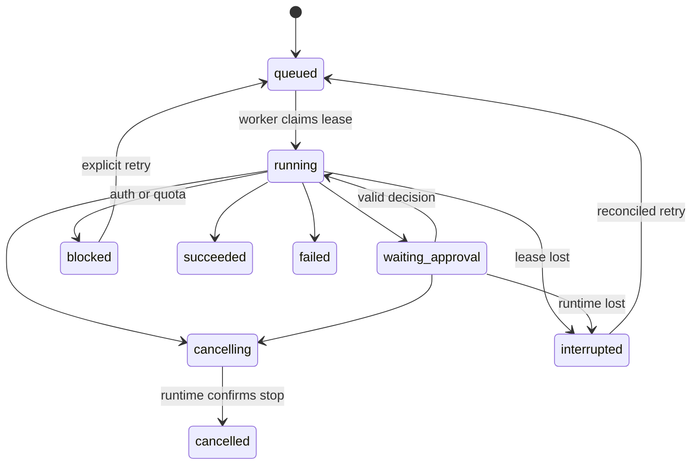

# Data, APIs and execution lifecycle

## Proposed records

| Entity | Main fields |
| --- | --- |
| users / sessions | issuer, subject, role; session hash and expiry |
| workspaces | owner, canonical root, policy version |
| conversations / messages | workspace, runtime thread mapping; role, content, timestamps |
| tasks | goal, workspace, profile, desired status |
| runs | task/conversation, status, attempt, lease, provider turn, timestamps |
| events | run, increasing cursor, kind, sanitized payload |
| approvals | run, provider request, action digest, expiry, resolution |
| artifacts | workspace, run, validated relative path, size, media type |
| memories | workspace, text, source, explicit approval, version |
| schedules / occurrences | timezone, expression, next due; unique scheduled instant |
| audit | actor, operation, target, outcome, timestamp |

Store UTC instants. Display and evaluate user schedules using an explicit IANA timezone, initially proposed `Asia/Jerusalem`, including daylight-saving transitions. Define whether an ambiguous local time runs once or twice; default once, skip nonexistent local times with a visible event. Keep application state separate from Codex-managed thread state; both are needed for faithful recovery.

SQLite WAL resides on local disk. Use brief transactions, busy timeout, schema migrations, indexes on queue status/events, and a single worker initially. Never hold a transaction while waiting on model/network work. Add PostgreSQL only when multiple hosts or measured contention justify it.

## Run lifecycle

Also permit cancellation from queued/blocked without runtime calls. Approval rejection is recorded and passed to the runtime; it is not automatically equivalent to task cancellation. After cancellation, record side effects that may already have occurred. If shutdown cannot be confirmed, retain interrupted/uncertain status rather than reporting cancelled.

API saves the user message and dispatch intent atomically. Worker claims a run with a conditional update and renewable lease; durable intent precedes external execution. Persist provider IDs and activity as available. Leases alone cannot fence a still-running external process: stop/reconcile the previous process before starting another run. Do not automatically replay uncertain side-effectful work. Exactly-once external execution is not promised.

Browser reconnects replay ordered events after its last cursor, then receive new ones. Apply bounded buffers and retention; publish a reset/snapshot response when a cursor is older than retained history. SSE is delivery, not the source of truth. The provider thread remains the authoritative provider conversation state; Pips retains its own user-facing history and mappings.

Scheduled occurrences have a unique `(schedule_id, scheduled_for)` key. Scheduler creates queue entries, never directly executes them. Default missed-run policy: coalesce to one occurrence, prevent overlap and apply bounded retry/backoff. Auth/quota failures block dispatch visibly rather than busy-looping. A schedule is not a continuous agent thought loop.

## Proposed HTTP surface

- `GET /auth/login`, `GET /auth/oidc/callback`, `POST /auth/logout`
- `GET /api/session`, `GET /api/runtime/status`
- `GET|POST /api/conversations`, `GET /api/conversations/{id}`
- `POST /api/conversations/{id}/messages` with client idempotency key
- `GET /api/runs/{id}`, `GET /api/runs/{id}/events?after=cursor`
- `POST /api/runs/{id}/cancel`
- `POST /api/approvals/{id}/decision`
- Later: `/api/tasks`, `/api/schedules`, `/api/memories`, `/api/artifacts/{id}`

Enforce owner/workspace authorization on every resource lookup. Return domain errors such as `authentication_required`, `quota_blocked`, `approval_expired` and `runtime_incompatible`; do not leak raw provider exceptions. App-server RPC is private implementation detail, not an endpoint forwarded to users.
